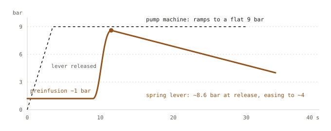

# Morning Brief No. 1

**Tuesday 10 November 2026** · Edition 001 · compiled overnight by 23 agents · about 30 minutes to read; raw notes optional

*Two questions went into the overnight queue: is a morning brief worth having at all, and how do you get a lever-pulled espresso to the bedside without a robot arm? Short answers: yes, on conditions; and in modules, starting with your brother's grinder.*

> **Part 1 · Do briefs work?** Probably yes, within narrow limits. Structured briefs and handoffs help when the reader has bought in and turn into ritual when they don't. AI summaries of the open web still get a large share of news answers materially wrong: 45% had a significant issue in the EBU's 2025 study. Keep this brief if it replaces other checking, stays under ten minutes, says how each claim was verified, and passes a kill test: after 20 editions, count what you acted on.
>
> **Part 2 · Espresso.** Build it as modules that each work by hand first, with motors that only push and never hold. Start with the grinder on a one-way clutch. Next, a push-only actuator on a Cafelat Robot (about $399). Then one enclosure with a thermoblock and an ESP32 that you arm at night and that brews an Americano at the alarm. That is roughly $1,250-2,200 in parts and a winter of weekends, by our estimate. If you want a daily machine meanwhile, a Gaggia Classic Pro with GaggiMate is the cheapest scriptable setup.

Web version, with the raw research rendered: [claude.ai/artifact/5Qwj24LYuit5ecydYHp2Cn](https://claude.ai/artifact/5Qwj24LYuit5ecydYHp2Cn) (private to you)

9 research slices · 461 searches · 142 claims fact-checked (64 verified, 51 partial) · about 36,000 words of raw notes in [`research/`](research/)

---

## Part 1: Does a morning brief actually work?

**Verdict.** Probably yes, within narrow limits. No study tests the thing itself, a single curated technical digest read once a day, so the case rests on neighbouring evidence. Structured briefings and handoffs help when the people using them have bought in and fail when they become ritual, and both frequent checking and AI summaries of the open web have measurable costs. This brief is worth keeping if it replaces other checking rather than adding to it, stays short enough to finish, says how sure it is of each claim, and gets cut the week it stops changing what you do. Because an AI writes it, the last two conditions carry most of the weight.

### What the evidence can and cannot show

Start with the gap. The research found no experiment on reading a personal digest, no study of reading news first thing versus later, and no independent accuracy audit of any commercial daily-brief product. What exists is adjacent: surgical checklists, clinical handoffs, intelligence forecasting, email-checking trials and audits of AI assistants. A team briefing before an operation coordinates a team with a shared task; your brief is one reader and a pile of links. Read what follows as argument from analogy, with small, self-reported or before/after studies labelled as such.

### The case for

**Structure helps when people mean it.** The cleanest clinical result is I-PASS, a structured handoff protocol ([Starmer et al., NEJM 2014](https://www.nejm.org/doi/full/10.1056/NEJMsa1405556)). Across nine hospitals and 10,740 admissions, medical errors fell from 24.5 to 18.8 per 100 admissions (23%) and preventable adverse events from 4.7 to 3.3 (30%). Nonpreventable events, which a handoff should not touch, barely moved (3.0 vs 2.8, P=0.79): a decent negative control. The caveats: pre-post design with no concurrent control, and three of the nine sites showed no significant change.

Surgical checklists sharpen the lesson. Haynes and colleagues ran the WHO checklist in eight hospitals with 7,688 patients; deaths fell from 1.5% to 0.8% and complications from 11% to 7% ([Harvard Gazette summary](https://news.harvard.edu/gazette/story/2009/01/surgical-safety-checklist-drops-deaths-and-complications-by-more-than-one-third/)). Then Ontario mandated it across 101 hospitals, and adjusted mortality went from 0.71% to 0.65% across 109,341 and 106,370 procedures, not a significant change ([Urbach et al., NEJM 2014](https://www.nejm.org/doi/full/10.1056/NEJMsa1308261)). A Michigan Medicare analysis against 950 comparison hospitals found a 30-day mortality RR of 1.03 (0.97-1.10) and $516 more per admission ([Reames et al., Medical Care 2015](https://www.ovid.com/jnls/lww-medicalcare/abstract/10.1097/mlr.0000000000000277~evaluation-of-the-effectiveness-of-a-surgical-checklist-in?redirectionsource=fulltextview)). The defenders' reply, Gawande's among them, was that Ontario mandated the form without training anyone or measuring whether it was used. That is an inference, not a finding. The WHO form anticipates the problem in its own text: "[This checklist is not intended to be comprehensive.](https://www.who.int/docs/default-source/patient-safety/9789241598590-eng-checklist.pdf)"

**Calibrated analysts exist.** Mandel and Barnes scored 1,514 strategic forecasts made by a Canadian intelligence unit between 2005 and 2011 and found discrimination and calibration that they called very good ([PNAS 2014](https://pmc.ncbi.nlm.nih.gov/articles/4121776/)). So a daily product that attaches probabilities to its judgements can be held to account and can pass.

**People who do your kind of work already run something like this.** Terence Tao wrote in October that he can mostly keep track of whether someone has solved a problem he is working on by watching the arXiv each night, a system he calls imperfect but very useful ([Tao, 2026-10-01](https://terrytao.wordpress.com/2026/10/01/arxiv-updates-its-rate-limiting-policy/); paraphrased, as the exact sentence was not confirmed). Andrej Karpathy, in February: "[Finding myself going back to RSS/Atom feeds a lot more recently. There's a lot more higher quality longform and a lot less slop intended to provoke.](https://x.com/karpathy/status/2018043254986703167)" His reading method is the one this brief's raw files are meant to support: "[pass 1 is manual, then pass 2 'explain/summarize', pass 3 Q&A](https://x.com/karpathy/status/1990577951671509438)". The manual pass comes first.

Even the patron saint of disconnection had a filter. Knuth gave up email in 1990, but his secretary prints the messages that matter and he answers on paper ([Knuth's help page](https://cs.stanford.edu/~knuth/help.html)). That is an overnight agent with a human in the job.

### The case against

**Attention is the budget.** Herbert Simon, 1971: "[What information consumes is rather obvious: it consumes the attention of its recipients.](https://deeshaa.org/2015/06/30/herbert-simon-information-consumes-attention/)" And: "Hence a wealth of information creates a poverty of attention." Simon's own conclusion was that you need a filter, which is an argument for a brief that cuts intake and against one that adds to it.

Knuth puts the personal version best: "[Email is a wonderful thing for people whose role in life is to be on top of things. But not for me; my role is to be on the bottom of things.](https://cs.stanford.edu/~knuth/email.html)" Also: "[I have been a happy man ever since January 1, 1990, when I no longer had an email address.](https://cs.stanford.edu/~knuth/email.html)" Bottom-of-things work is the kind a daily brief can quietly eat.

Taleb's argument in *Antifragile* is statistical: sample a slow process too often and noise swamps signal. Assuming 1:1 on a yearly view, his stylised split is roughly 95% noise at daily resolution and 99.5% at hourly ([Farnam Street](https://fs.blog/noise-and-signal-nassim-taleb/); figures confirmed, exact wording not). A daily brief about things that change monthly is mostly noise by construction.

**Checking has a cost, though smaller than the folklore says.** Kushlev and Dunn had 124 adults alternate a week of checking email three times a day with a week of unlimited checking; stress was lower in the limited week, and the unlimited checkers did not feel more productive ([UBC summary](https://psych.ubc.ca/news/checking-your-email-less-can-help-reduce-stress-new-study-by-phd-candidate-kostadin-kushlev/)). Participants found the limit hard to keep. Gloria Mark's group took 13 workers off email for five days and window switching fell from 37 to 18 per hour ([UCI, CHI 2012](https://news.uci.edu/2012/05/07/email-vacations-decrease-stress-increase-concentration)); tiny sample. Sophie Leroy's "attention residue" work adds a mechanism: an unfinished task left open in your head degrades performance on the next one ([Leroy 2009](https://econpapers.repec.org/RePEc:eee:jobhdp:v:109:y:2009:i:2:p:168-181)). A brief that opens loops just before deep work is the bad case.

**Order steers attention, whatever the quality.** The arXiv listing is a daily brief, and Haque and Ginsparg measured what its order does ([arXiv:0907.4740](https://arxiv.org/abs/0907.4740)). Papers in position 1 got 82%, 61% and 58% more early downloads in astro-ph, hep-th and hep-ph, and median citations 83%, 50% and 100% higher. Most of that gap is authors timing submissions to land first, but papers that landed on top by accident still got a long-term citation boost of 44%, 38% and 71%. An informal reanalysis by Motloch suggests the pure position effect is smaller still ([blog](https://motloch.net/blog_entries/arxiv_submission_analysis.html)). Even taking the low reading, whatever sits at the top of this brief will get more of you than it has earned.

**The warning can be in the brief and still not land.** The 9/11 Commission titled its eighth chapter with Tenet's phrase "[the system was blinking red](https://9-11commission.gov/report/911Report_Ch8.pdf)". The daily product carried warnings. On one reading, arriving every day turned out to be different from being acted on; the lesson is contested.

**Novelty fades, and the products show it.** OpenAI launched ChatGPT Pulse in September 2025 as a $200-a-month Pro preview that researched overnight and served morning cards ([Axios](https://www.axios.com/2025/09/25/chatgpt-prompts-you-pulse-openai)). One Tom's Guide reviewer, who tests AI for a living, headlined hers "[This is hands down the worst new AI tool of 2025 — and I regret ever turning it on](https://www.tomsguide.com/ai/i-test-ai-for-a-living-and-this-is-hands-down-the-worst-new-ai-tool-of-2025)". Blog reports say OpenAI retired Pulse in mid-2026 in favour of user-defined scheduled tasks; the release note itself was not seen and the reported dates conflict, so treat that as unverified. Huxe, an audio briefing app from former NotebookLM developers, shut down in May 2026 ([TechCrunch](https://techcrunch.com/2026/05/22/audio-generation-app-huxe-founded-by-former-notebooklm-developers-shuts-down/)). I found no usage numbers for either, so "nobody wanted it" is my inference, not a finding.

### What people who brief for a living have learned

Four lessons recur, and they separate a working brief from theatre.

*The conversation matters more than the freshness.* David Priess, a former CIA daily briefer: "[The advantage of having a briefer in the room comes much less from his or her ability to deliver late-breaking updates than from his or her ability to answer questions, discuss analytic nuances, or provide information that would not have come out without conversation.](https://roguewomenwriters.com/david-priess-goes-rogue-the-presidents-book-of-secrets-a-review-and-interview-with-author-david-priess/)" Your briefer in the room is the raw research plus a follow-up question; the summary is the lesser part.

*Words need numbers.* Sherman Kent's 1964 essay pinned estimative words to odds ([GlobalSecurity](https://www.globalsecurity.org/intell/ops/probability.htm)):

| Phrase | Kent's midpoint |
|---|---|
| almost certain | 93% |
| probable | 75% |
| chances about even | 50% |
| probably not | 30% |
| almost certainly not | 7% |

The usual origin story is a 1951 estimate calling a Soviet move on Yugoslavia a "serious possibility", which Kent meant as roughly 65:35 and colleagues read very differently ([Wikipedia](https://en.wikipedia.org/wiki/Words_of_estimative_probability); this anecdote was not independently checked). The lesson does not depend on the details. If "likely" means different things to writer and reader, the word carries no information.

*Ritual is the failure mode.* "[PowerPoint makes us stupid](https://www.nextgov.com/modernization/2010/05/powerpoint-combatants-go-at-it-again/251255/)," General Mattis told a 2010 conference. A complaint, not data, but it fits Ontario: form without buy-in may do little. A brief read because it is 8am, whether or not anything changed, is the slide deck nobody needed.

*Short beats complete.* The WHO's form says it is not comprehensive; my reading is that its job is to catch the few failures that matter. A brief that tries to cover everything has forgotten what it is for.

### How an AI-written brief fails, and what to do about it

Open-web error rates are high enough to design around. A study by 22 public-service broadcasters across 18 countries and 14 languages, covering 3,000+ answers, found 45% had at least one significant issue, 31% had sourcing problems, and Gemini reached 76% ([EBU, Oct 2025](https://www.ebu.ch/news/2025/10/ai-s-systemic-distortion-of-news-is-consistent-across-languages-and-territories-international-study-by-public-service-broadcaste)). "Significant issue" is broader than "wrong". The EBU's Jean Philip De Tender: "This research conclusively shows that these failings are not isolated incidents." The Tow Center asked eight AI search tools to identify the source of quoted excerpts; collectively they were wrong more than 60% of the time, from 37% (Perplexity) to 94% (Grok 3) ([CJR, Mar 2025](https://www.cjr.org/tow_center/we-compared-eight-ai-search-engines-theyre-all-bad-at-citing-news.php)). That task is narrow, but citation is exactly the job of a sourced brief.

The specific failures, each with its guardrail:

1. **Confident fabrication in a trusted wrapper.** In December 2024 Apple's notification summary of a BBC alert falsely told users Luigi Mangione had shot himself. The BBC: "[It is essential to us that our audiences can trust any information or journalism published in our name, and that includes notifications.](https://uk.finance.yahoo.com/news/apple-ai-tools-bbc-complaint-090531355.html)" RSF called generative AI "[too immature to produce reliable information for the public](https://rsf.org/en/rsf-urges-apple-remove-its-new-generative-ai-feature-after-it-wrongly-attributes-false-information)". Apple paused news summaries in January 2025 ([CNBC](https://www.cnbc.com/2025/01/16/apple-disables-ai-notifications-for-news-in-its-beta-iphone-software.html)). Guardrail: every factual claim links to its original, and quotes appear only when the wording was matched.
2. **Overstated conclusions.** A 2025 Royal Society Open Science study of about 4,900 summaries from 10 LLMs found overgeneralised conclusions in 26-73% of cases depending on model ([DOI 10.1098/rsos.241776](https://doi.org/10.1098/rsos.241776)). Guardrail: keep the paper's own hedges, and say what a result does not show.
3. **Nobody clicks through.** Pew tracked 68,879 searches by 900 US adults: people clicked a result in 8% of visits with an AI summary against 15% without, and clicked a link inside the summary about 1% of the time ([Pew, Jul 2025](https://www.pewresearch.org/short-reads/2025/07/22/google-users-are-less-likely-to-click-on-links-when-an-ai-summary-appears-in-the-results/)). Guardrail: flag the one item per edition most worth checking yourself.
4. **Trust displaces checking.** Lee et al. surveyed 319 knowledge workers and found that more confidence in the AI went with less critical thinking, and more self-confidence with more ([Microsoft Research, CHI 2025](https://www.microsoft.com/en-us/research/publication/the-impact-of-generative-ai-on-critical-thinking-self-reported-reductions-in-cognitive-effort-and-confidence-effects-from-a-survey-of-knowledge-workers/)). It is self-report. Guardrail: a visible verification status on every claim, so trust attaches to the check rather than the prose.
5. **Omissions you cannot see.** Simon Willison's point about deep research: checking references catches most invented claims, but missing material leaves no trace, and a polished document looks more complete than it is ([Willison, Feb 2025](https://simonwillison.net/2025/Feb/25/deep-research-system-card/)). Guardrail: list what was searched, what could not be opened, and what was not covered.
6. **Silent pipeline failure.** Stephan Miller found his home agent's scheduled job had quietly failed while still producing plausible output; his fix was to move the plain fetch-and-report jobs to ordinary cron and keep the model for synthesis ([Miller](https://www.stephanmiller.com/my-home-ai-agent-kept-making-shit-up/)). Guardrail: deterministic fetching outside the model, and a status line that fails loudly.

Tao's position is the right default for a mathematician. His AI-views page treats AI as safer as a fast search engine than as a summariser of papers you could not read unaided, and literature search as useful only if you can check that the references say what is claimed ([Tao, AI views](https://teorth.github.io/tao-web/ai-views.html); the page notes it was drafted by Claude and reviewed by Tao, which is either reassuring or recursive).

### House rules for this brief

1. **Bottom line first, hard cap after.** A three-sentence BLUF, then at most five items, readable in ten minutes. The raw research is optional, never homework. If an edition runs long, cut items rather than shrinking them.
2. **Read it at a break, not on waking.** It arrives overnight but is designed to be read after your first deep-work block or at a natural transition. Sleep inertia impairs judgement for a while after waking ([Hilditch and McHill 2019](https://pmc.ncbi.nlm.nih.gov/articles/PMC6710480); the often-quoted 30 minutes is not firmly established), and anything that opens a loop is better read after the hard thinking than before it.
3. **Numbers behind the words.** Likelihood words follow Kent's table, with a number in brackets where it matters. Every claim carries a status (verified, partial, unverified) and says how it was checked. "Matched across three search results" is not the same as "read the paper", and the brief will say which.
4. **Link originals, quote only what was matched.** Inline links go to primary sources where they exist. A quote appears verbatim only if the wording was confirmed; otherwise it is paraphrased and marked. Numbers follow the same rule.
5. **Rank by consequence, and say why.** Given what position 1 does on the arXiv, item 1 gets a one-line reason for being item 1. Novelty alone is not a reason.
6. **Leave things out on purpose.** No general news, nothing that cannot change a decision or a reading list, no slow story repeated daily. "Nothing material changed" is a valid edition and beats padding.
7. **Show the plumbing.** A closing status line: what ran, what failed, what could not be opened, what was out of scope. Omissions are listed, not implied.
8. **A kill test.** After 20 editions, count the items you acted on or followed into the raw research. If the answer is near zero, shrink the brief to weekly or stop it. Pulse is the precedent.

## Part 2: Espresso to the bedside

**Bottom line.** Build the bedside machine as modules, and get each one working by hand before it gets a motor. Any motor you add should only push, never hold, so that cutting the power leaves an ordinary manual tool. That means three steps. First, motorise a hand grinder through a one-way clutch so the crank still works, and dose by weight. Second, fit a push-only actuator to a cheap direct lever (a Cafelat Robot, about $399) and learn the force and profile problem there. Third, combine the two in one enclosure with a thermoblock, a heated group, and a controller you arm by hand at night that brews at the alarm. Make the Americano the default drink. If you want a daily machine while you build, a Gaggia Classic Pro with a GaggiMate Pro kit (about $499 plus EUR 213) is a cheap, scriptable pressure-profiling setup. It is not a lever. My estimate for the full build is $1,250-2,200 in parts and a winter of weekends. Nobody has documented this exact machine, so treat that estimate as having fat tails.

Prices are approximate, US retail unless marked, as seen in listings around 10 November 2026. Check them before buying.

### What to look for in a machine

Start with the heat source. Boilers act as a heat battery: slow to warm (roughly 5-30 minutes) but stable. Thermoblocks heat in seconds to a minute and hold only a few millilitres, so they store almost no energy, which is what you want on a nightstand. The buying guides disagree widely on these numbers ([Craft Coffee Spot](https://craftcoffeespot.com/espresso/thermoblock-vs-thermocoil-vs-boiler/)), so read them as orders of magnitude.

A PID controller reads boiler temperature, not group temperature. Blogs put the offset on a Gaggia at anywhere from 5 to 12 C, which is unverified and contested.

Next, you need a pressure source you can command. The options are a vibration pump with phase-angle control (the Gaggiuino and GaggiMate approach), a speed-controlled gear pump, a spring, or your arm. Automation also needs a transducer. A 0-12 bar stainless one costs about $38 ([Peak Coffee](https://www.peakcoffee.cc/product/gaggiuino-pressure-sensor/)), though that is the vendor's price and a cached copy of the page showed $18.

Watch what touches the water. CW617N is a leaded brass, and the "lead-free CW617N" you will see advertised does not exist ([IFAN](https://www.ifanholding.com/news/cw617n-lead-free-brass)). NSF/ANSI 372 caps lead at a 0.25% weighted average over wetted surfaces ([NSF](https://standards.nsf.org/higherlogic/ws/public/download/55131/372i5r1%20-%20Normative%20Reference%20-%20JC%20Memo%20%26%20ballot.pdf)). It is a drinking-water standard, and I could not confirm how it applies to coffee gear. In anything you build, use 316 stainless wherever water touches.

Finally, make sure there is a way in. Breville shows the problem, whichever model your girlfriend has: the Dual Boiler BES920 is a lot of machine for $1,599.95 ([Breville US](https://www.breville.com/en-us/product/BES920)). But its automation hooks are the app on Wi-Fi models or a relay hack, plus one explicitly unofficial Home Assistant integration that lists only the Oracle Dual Boiler ([sageha](https://github.com/simonjgreen/sageha)).

### How a lever makes pressure

On a direct lever (Robot, La Pavoni, Cremina) your arm is the pump. Brew pressure is handle force times mechanical advantage, divided by piston area, and the advantage changes with lever angle. On a spring lever (Strega, Profitec Pro 800, Elektra, Londinium), lifting the handle compresses a spring and lets water into the cylinder. When you let go, the spring does the work.

Take spring rate *k*, preload *x*₀ at the bottom of the stroke, and piston area *A*. With the piston a height *s* above the bottom, pressure is roughly *P(s) ≈ k(x₀ + s)/A*, less seal friction. At constant flow *Q*, the piston falls at *ds/dt = −Q/A*, so pressure falls linearly in time. In a real shot the puck erodes and flow rises, so the decline steepens toward the end. The preload sets the end pressure and the stroke adds the peak, which is why swapping the spring changes both.

A lever retailer's blog describes one illustrative shot that peaks at 8.6 bar and falls to 3.7 bar ([The Lever Blog](https://thelevermag.com/blogs/articles/decent-espresso)); that is one shot, not a benchmark. Other sources claim peaks from 7.5 to 12 bar, but none shows a transducer trace (unverified). On force, one Home-Barista user's bathroom-scale reading came to about 24 lb at the handle for 6 bar and about 40 lb for 9 bar ([Home-Barista](https://www.home-barista.com/levers/pressure-profiling-la-pavoni-t34126.html); the post may sit in a related Cremina profiling thread). Other estimates for 9 bar run from 25 to 48 lb. Use these for rough actuator sizing only.

*Schematic, not a measurement. The lever line follows one published shot description (about 8.6 bar falling to about 3.7 bar over roughly 30 s) and owner reports of 7.5-8.5 bar peaks. Preinfusion near 1 bar is boiler pressure on a boiler-fed spring lever. No transducer trace could be opened overnight, so read this as the typical shape rather than data.*

The case that a declining profile tastes better comes mostly from people who sell machines. Decent, which sells pump machines that imitate lever curves, argues that 9 bar is a leftover from 1940s spring sizes ([Decent](https://decentespresso.com/blog/the_nine_bar_question)). I found no controlled taste trial.

### Machines that work by hand and can be automated

| Machine | Mechanism | Automation route | Price (approx.) | Honest drawback |
|---|---|---|---|---|
| Cafelat Robot | Direct lever, no electronics | None built in; good actuator testbed | $399 ([Prima](https://prima-coffee.com/brew/espresso/home/cafelat/)) | No heater; you supply hot water |
| La Pavoni Europiccola EPC-8 | Direct lever on small boiler | PID and pressurestat mods | $1,108 ([WLL](https://www.wholelattelove.com/products/la-pavoni-europiccola-epc-8-espresso-machine)); $989 on sale at another retailer | Owners report the group overheats after 2-3 shots |
| Olympia Cremina | Direct lever, Swiss | Bluetooth portafilter sensors for logging | $4,305 ([Cerini](https://www.cerinicoffee.com/products/olympia-express-cremina-espresso-machine-made-in-switzerland)) | Price; same thermal juggling |
| Elektra Micro Casa a Leva | Spring lever on boiler | Little | $1,599 when tested ([CoffeeGeek](https://coffeegeek.com/reviews/firstlooks/elektra-micro-casa-a-leva/)); about $2,029 at one retailer now | Group heat is a known con |
| Bezzera Strega | Spring lever plus vibe pump | Pump fill is electric; lifting the lever cuts the pump | $2,699 ([WLL](https://wholelattelove.com/bezzera-strega-lever-espresso-machine)) | Owners complain of pump noise |
| Profitec Pro 800 | Spring lever, pump only fills, dual boiler | Little | $3,199-3,299 ([WLL](https://www.wholelattelove.com/products/profitec-pro-800-lever-group-espresso-machine)); $2,968 on sale elsewhere | Nothing to hook into |
| Lelit Bianca V3 | Rotary pump, manual flow paddle | Hand profiling at the paddle | $2,999.95 ([WLL](https://www.wholelattelove.com/products/lelit-bianca-v3-dual-boiler-espresso-machine)) | Not a lever |
| Meticulous | Motor-driven piston, ten sensors | Open API, per the maker | $1,350 CES 2025 preorder ([TechCrunch](https://techcrunch.com/2025/01/07/meticulous-shows-off-its-smart-espresso-machine-at-ces-2025)); current retail unconfirmed | No lever for a hand |
| Gaggia Classic Pro E24 + GaggiMate Pro | Vibe pump, small boiler, ESP32 | Web UI, WebSocket, pressure and flow profiles | $499 sale, $549 list ([WLL](https://www.wholelattelove.com/collections/gaggia/products/gaggia-classic-pro)) plus EUR 213.49 | Not a lever; plastic accessories |

The Strega comes closest to your brief: pump for the fill, spring for the extraction, lever as the switch. But nothing on it accepts a command.

Meticulous is the mirror image. It has ten sensors and a scale under the drip tray ([SCA](https://new.sca.coffee/entries/meticulous-espresso)), and a July Kickstarter update says the API is open, with TypeScript and Python clients ([Kickstarter](https://www.kickstarter.com/projects/meticulous/meticulous-espresso/posts/4143589)). But you can't pull it by hand, and the $1,850 retail price that circulates is unverified.

New and expensive does not mean reliable. CoffeeGeek's Mark Prince headlined his piece on the new Olympia Mina "A Beautiful, Frustrating Swiss Paradox" (12 Nov 2025), and it relays a valve failure after about a month of daily use ([CoffeeGeek](https://coffeegeek.com/opinions/coffee-at-the-moment/olympia-mina-beautiful-flawed-paradox/)). Decent's DE1 is a very scriptable pump machine. Decent says its tablet software and API are open, and pyDE1 is GPL-3.0 ([pyDE1](https://github.com/jeffsf/pyDE1)). I couldn't verify its current price, so it isn't in the table.

### If you would rather buy than build

Three tiers, using only prices the fact-checker could confirm (US, approximate, November 2026). The cheapest tier is the one that automates best, which tells you where the money in this project should go.

| Tier | Machine | Grinder | Rough total | Lever alternative |
|---|---|---|---|---|
| About $600-1,000 | Gaggia Classic Pro E24 ($499 sale, $549 list) plus GaggiMate Pro (EUR 213) | 1Zpresso J-Ultra ($199) | about $950 | Cafelat Robot ($399) plus J-Ultra, about $600; you supply hot water |
| About $1,500-2,700 | Breville Dual Boiler ($1,599.95) or Rancilio Silvia Pro X (about $2,195) | DF64 Gen 2 ($399-450, [DF64](https://df64coffee.com/a/s/products/df64-gen-2-single-dose-coffee-grinder)) | about $2,000-2,650 | La Pavoni Europiccola ($1,108) plus J-Ultra, about $1,300 |
| $3,500 and up | Lelit Bianca V3 ($2,999.95) or La Marzocco Linea Micra (about $3,900, [Gear Patrol](https://www.gearpatrol.com/drinks/la-marzocco-linea-micra-review/)) | Niche Zero (about $599-649, [price guide](https://completehomebarista.com/guides/niche-zero-price-guide-2026/)) | about $3,600-4,550 | Profitec Pro 800 ($3,199-3,299) or Olympia Cremina ($4,305) |

Only the first row has a documented pressure-and-flow automation path. The Silvia Pro X already has dual PIDs, and the open CleverCoffee project targets the base Silvia and controls temperature only. The Breville's hooks are the ones described above. The middle and top tiers buy temperature stability and steam. They do not buy anything that helps with getting a cup to the bedside.

### Three build paths

| Path | Parts (approx.) | Time | Skills | Main risk |
|---|---|---|---|---|
| 1. Modify a pump machine | $750-900 | 1-3 weekends | Mains wiring, crimping, light plumbing | Mains faults; licence limits |
| 2. Lever plus added automation | $800-2,000 | 2-4 months of weekends | Mechanism design, motor control | Actuator sizing, kickback, heat |
| 3. From scratch | $1,500-4,000 | 100-300 h | Machining, pressure plumbing, safety | Pressure vessel, lead, time |

Times, and the costs for paths 2 and 3, are my estimates from the anecdotes below.

**1. Modify an existing machine.** The GaggiMate Pro kit is EUR 213.49 on the official shop, with about a two-week restock ([GaggiMate shop](https://shop.gaggimate.eu/products/gaggimate-pro-kit)). You need the Pro rather than the Standard (from EUR 152.49) for pressure and flow profiles. The repository has 995 stars and a CC BY-NC-SA 4.0 licence ([GitHub](https://github.com/jniebuhr/gaggimate)). Its releases page marks v1.9.0 (29 September) as latest; the docs still say v1.7.3, so trust the releases page. Upstream describes an automatic shutoff if the controller hangs or overheats, which is the feature you want most at a bedside.

Gaggiuino is older and bigger, with 2.7k stars and 2,380 commits ([GitHub](https://github.com/Zer0-bit/gaggiuino)). Aftermath reports that its author took the current generation closed-source because of scalpers, in an "open-core" model ([Aftermath](https://aftermath.site/gaggiuino-gaggia-classic-pro-mod-open-source-hack/)). Costs are forum anecdote: $388 for one premium kit, and about $400 in one [build log](https://kozikow.wordpress.com/2024/02/22/gaggiuino-build-log/) that says going below $250 is hard. If you want a properly open licence, CleverCoffee is GPL-2.0 ([GitHub](https://github.com/rancilio-pid/clevercoffee)), but it only controls temperature.

This path ends with a scriptable machine, but no lever, grinder or bedside cup.

**2. A lever or lever hybrid with automation added.** You've ruled out a robot arm on an unmodified machine. An actuator built into the frame, through a coupling that can only push, is a different thing: retract it and the lever is just a lever. The closest precedent is Alex Moyse's 2018 La Pavoni project. He used a refurbished 500 lb Thomson linear actuator that he called "complete overkill for the La Pavoni" ([alexmoyse.com](https://alexmoyse.com/?page_id=75)). I found no record of the result, or of whether the lever still worked by hand. One GitHub project puts two linear actuators and an ESP32 on a Flair 58; its author says pressure sensing isn't there yet ([flair_eva_project](https://github.com/johnrbell/flair_eva_project), unverified).

From the force readings above, about 180 N (40 lb) at the handle covers 9 bar. Double it for stiction and you have a small lead-screw actuator, not a 500 lb one. Forum posters warn that Pavoni internals aren't really built for a steady 9 bar ([Home-Barista](https://www.home-barista.com/levers/robo-pavoni-learning-to-make-espresso-machine-from-scratch-t4141.html)), which points to the Robot as the testbed.

A spring lever is simpler in one way: the motor only cocks it, so the profile stays mechanical. It is worse in another, because a spring lever can kick back hard if something releases it under load (my reasoning, not sourced). I found no consumer motor-assisted spring lever, so this is open ground.

**3. From scratch.** One open-boiler lever took about EUR 280 in parts and an estimated 70-80 hours. Another took about 120 hours and EUR 1,300. A 36-page thread, "[Building a lever machine.... from scratch](https://www.home-barista.com/levers/building-lever-machine-from-scratch-t41716.html)", includes a month spent converting a lathe to CNC while the builder waited for a casting. (All unverified forum figures.) diyPresso is a halfway house: open firmware, One at EUR 1,250 (no steam), Two at EUR 1,695 ([diyPresso](https://www.diypresso.com/product/diypresso-one/)). Hackaday said it "might not be the cheapest road to obtaining an espresso machine" ([Hackaday, 2024](https://hackaday.com/2024/09/15/an-espresso-machine-for-the-diy-crowd/)).

The hard limits are regulatory. The EU Pressure Equipment Directive applies only above 0.5 bar, and anything under its Article 4(1) thresholds falls under "sound engineering practice" ([PED guidelines](https://www.ce-richtlinien.eu/richtlinien/Druckgeraete/Leitlinie/PED_2014-68-EU_Guidelines_EN_v6.0.pdf)). I couldn't confirm where those thresholds fall for a small boiler. So skip the steam boiler and use thermoblocks. If you do build a boiler, fit a certified, marked safety valve. One retailer sells 2.1 bar valves for home boilers and warns never to fit a lower-rated one or bypass it ([Espressoparts](https://www.espressoparts.com/products/espresso-machine-1-4-boiler-safety-valve)). Others still sell 1.8 bar valves, so match the boiler's rating.

For a pump-driven build, the natural actuator is a Fluid-o-Tech FG gear pump: 316L, 24 V brushless, speed-controlled, 30-210 l/h, up to 12 bar ([Fluid-o-Tech](https://www.fluidotech.it/en/products/technologies/external-gear-pumps/fg200-300-series/)). Prices are all over the place: $880-1,331 new at one dealer depending on the snapshot, and about $600 new or $95 used per forum posts.

### Your brother's grinder

I can't identify it from the description. A metal barrel with knurling and a crank fits half the premium hand grinders on sale, and no source treats knurling as a distinguishing mark. A few checks narrow it quickly:

- Look for engraving on the barrel, the crank arm or the top nut.
- See where the adjustment is. An external numbered dial just under the crank suggests a 1Zpresso J-Ultra or K-Ultra (the J-Ultra's handle also folds). A stepless numbered ring suggests a Kinu M47.
- Weigh it. A Kinu M47 Phoenix is about 0.7 kg ([Home Grounds](https://www.homegrounds.co/kinu-m47-review/)); one retailer's 1.4 kg figure is contradicted elsewhere.
- Wooden parts suggest a Comandante, which leans toward filter.

For reference, the reviewers' espresso pick, the 1Zpresso J-Ultra, is $199 ([1Zpresso](https://1zpresso.coffee/product/jultra)), and the X-Ultra is $159 ([1Zpresso](https://1zpresso.coffee/product/xultra)).

**Motorising it.** 1Zpresso is relaxed about this. Its FAQ says any 6.35 mm (1/4 inch) drill fits all its grinders and doesn't need to be powerful ([1Zpresso FAQ](https://1zpresso.coffee/faq/); paraphrased, since the same wording appears on a rival's FAQ). The advice to run a drill only briefly to avoid heat is verbatim on a rival's FAQ, so I haven't attributed it to 1Zpresso. AeroPress excludes drill-adapter damage from its own grinder's warranty. I found no stated policy from Kinu, Timemore or Comandante.

On torque, a hobbyist on the ODrive forum wrote: "With a fine grind setting I measured about 3 Nm, so assuming 6 to have some headroom" ([ODrive forum](https://discourse.odriverobotics.com/t/research-motorizing-manual-coffee-grinder/6979)). One anonymous measurement. Measure your brother's grinder yourself: hang a luggage scale from the crank knob and multiply by the radius. At a 6 cm crank, 3 Nm is about 5 kgf. On speed, forum reports (unverified) put hand cranking near 120 rpm and say throughput stops improving around 80 rpm because the beans stop feeding. One builder ran a motorised HG-1 at 40-50 rpm for espresso. So you want a gearmotor or geared stepper giving 6-10 Nm at 40-120 rpm, not a drill at 400.

**Keeping the crank.** A hand grinder doesn't freewheel. Bolt a motor to the shaft and the crank goes along for the ride, and a geared motor acts as a brake when you crank by hand. I found no documented build that solves this. The design I'd try replaces the crank nut with an adapter stub. The crank refits on top of the stub. Below it sits a timing-belt pulley on a sprag (one-way) clutch, driven by a gearmotor mounted to the side. When the motor drives, the sprag locks and turns the shaft. When you crank, the shaft overruns the stationary pulley and the motor is never back-driven. Support the stub in its own bearing in the frame and join it to the grinder shaft with an Oldham or jaw coupling. That keeps belt tension off the grinder's top bearing and absorbs misalignment. A soft-jawed collar around the barrel takes the reaction torque, which is the knurling's moment to be useful.

**Grind by weight.** Two open ESP32 projects use an HX711 and a load cell. [openGBW](https://github.com/jb-xyz/openGBW) adjusts its overshoot offset after each grind: "the accuracy will increase with each grind". [smart-grind-by-weight](https://github.com/jaapp/smart-grind-by-weight) aims for ±0.03 g, which is a design goal with no measured data, and calls itself experimental. Both target Eureka electric grinders. A single-dose hand grinder allows simpler control: weigh the beans in, grind to empty, and detect empty when motor current drops to idle.

One guide rates a Comandante C40 at 43 dB(A), a peak during full-torque cranking, against 59 for a Eureka Silenzio and 62 for a DF64 Gen 2 ([Bean Brew Digest](https://beanbrewdigest.com/equipment-gear/what-is-the-most-quiet-coffee-grinder-available)). The distance isn't stated, and another site puts hand grinders at 70-75 dB on a different basis. Hand grinders are probably quieter, but the published numbers can't be compared.

### Concept: a Teasmade for espresso

The Teasmade goes back to patents from 1891 and 1902 (Rowbottom, then Clarke, per the enthusiast site [teasmade.uk](https://www.teasmade.uk/1891-samuel-rowbottom)); Goblin brought it to market in the mid-1930s. Its cycle ends itself. An alarm clock switches on a sealed kettle, and steam pressure pushes the water into the pot. The empty kettle then releases a switch beneath it, which cuts the element and sounds the buzzer ([Hackaday](https://hackaday.com/2020/01/30/retrotechtacular-teasmade)). If the seal leaks, you just get no tea. That failure is benign, and that is the property to copy.

The Barisieur ($445, or $399 on offer in 2019 per [Salon](https://www.salon.com/2019/04/06/this-coffee-maker-alarm-clock-will-change-your-am-game)) lets you choose before, at or after the alarm, but it brews filter coffee. The robot cafes are the warning. Cafe X closed its San Francisco sites in January 2020 and its airport sites that August ([ABC7](https://abc7news.com/post/robot-baristas-cafe-x-closes-sf-locations-/5830767/)). Briggo's enclosed kiosk became Costa's BaristaBot ([BevNET](https://www.bevnet.com/news/2020/costa-coffee-acquires-rebrands-briggo-machine-as-baristabot/)), and the enclosed, fixed layout is the design that was acquired rather than closed. Arms aren't ready for this. An SO-101 costs about $100-130, and the best documented result I found is 17 of 20 cube placements on one fixed setup ([HF model card](https://huggingface.co/omiya239532/so101_act_cotrain)).

**Architecture.**

| Component | Choice | Why |
|---|---|---|
| Heat | About 1 kW thermoblock for brew and Americano water, a 100-200 W cartridge heater in the group, a PID on each, and bimetal cutouts wired in series outside the firmware | Little stored energy; group mass handled separately |
| Pressure | Lever group with a push-only actuator (a roller in an open cradle under the lever, free when retracted); a small pump fills the cylinder at low pressure, as on the Strega | Profile stays mechanical; a hand can do everything |
| Grinder | The sprag-coupled motorised hand grinder | Crankable with the power off |
| Dosing | Beans pre-weighed into a sealed tube at night; ground through a funnel into a basket on a load cell; spring-loaded tamper on a lead screw | Puck prep is the hard chore; kiosks only solved it in enclosed machines |
| Basket | Drawer portafilter on a rail: out to dosing, in under the group, cam-lifted to seal | Superautomatic brew units show dose-tamp-eject fits in a shoebox (my inference; untested with a lever) |
| Water | 1-1.5 L tank, level sensor, low-water heater cutout; one Third Wave Water packet per gallon of distilled or RO water, as Clive suggests ([Clive](https://clivecoffee.com/products/third-wave-water-packets-12-pack)) | No plumbing at a bedside |
| Cup | Fixed bay with cup-presence load cell, drip tray level sensor, double-wall glass | No cup, no brew |
| Control | ESP32 for real-time loops (GaggiMate as reference); Home Assistant or phone alarm over MQTT for timing | Interlocks don't depend on Wi-Fi |
| Trigger | A physical "arm" button pressed at night, then the alarm time; never runs unarmed | A queue for tomorrow, not a daily habit |
| Manual override | Actuator retracts clear of the lever; crank on the grinder; a switch that keeps heaters and PIDs but drops the scheduler | It should be a decent manual machine with the brain unplugged |

**Rough bill of materials** (my estimates unless sourced):

| Item | Approx. cost |
|---|---|
| Spring-lever group as a part (about $495 in one old forum thread, unverified), or a Robot to start | $400-600 |
| Thermoblock, group heater, PIDs, SSRs, thermal fuses | $100-200 |
| Pressure transducer ($38, vendor price) and Digmesa flow meter (roughly GBP 8-78) | $60-150 |
| Lead-screw lever actuator (about 500 N) and driver | $80-200 |
| Grinder gearmotor, sprag pulley, belt, bearings, coupling | $80-150 |
| Load cells, HX711s, ESP32s, display | $40-80 |
| 316L fittings, PTFE hose, valves, tank, enclosure | $300-600 |
| Hand grinder if not borrowed (J-Ultra) | $199 |
| Total | about $1,250-2,200, before mistakes |

**Build phases.**

1. Bench rig: thermoblock, PID and transducer on a plate, logging to a laptop. Characterise warm-up and the temperature dip at shot start. Builders warn that a block can lag the opening burst of flow, and that flow-based feed-forward helps ([Home-Barista](https://www.home-barista.com/espresso-machines/diy-espresso-machine-dual-thermoblock-dual-piston-pump-single-group-t77501.html)).
2. Grinder module, from torque measurement to grind-by-weight.
3. Lever module: hand shots with logging, then the actuator replaying your own curves.
4. Dosing and the drawer. This will take longest.
5. Interlocks, arm-and-expire logic, scheduling.
6. A month at the bedside with a phone decibel meter and a shot log.

**Constraints.**

The thermal budget is easy to work out. Heating water from 20 to 93 C takes about 305 J/g, so 1 kW delivers about 3.3 ml/s. That covers a 40 g shot in 30 seconds and 150 ml of Americano water in under a minute, and it agrees with a forum back-of-envelope figure of about 3 ml/s. The group is the slow part. Raising a 2.5 kg brass group by 70 K takes about 66 kJ, or about 7 minutes at 150 W before losses, so plan a 15-20 minute pre-alarm start. Don't leave a dosed basket in a hot group. The SCA's staling review links higher temperature to faster volatile loss ([SCA](https://sca.coffee/sca-news/2012/02/15/what-is-the-shelf-life-of-roasted-coffee-a-literature-review-on-coffee-staling-bjcx7)), which is why this design grinds and doses a few minutes before the alarm.

On noise, let the grinder be the alarm. It is the loudest part of the cycle either way, and grinding three minutes before you wake gives fresher coffee. Pump noise figures are only estimates (60-75 dB for vibe pumps in one guide), and how the pump is mounted matters as much as which type it is.

For scald and fire safety: no steam boiler, an RCD-protected outlet, a thermal fuse in series with each heater, and a tilt switch. Firmware should never be the only thing that can switch a heater off. A 2021 Topten/eceee paper says EU coffee machines ship with a 30-minute auto-off default that users can't lengthen ([Topten](https://storage.topten.eu/source/files/D2_1_Criteria_Paper_Coffee_Machines.pdf)), though the underlying regulation's status is muddled. Do the same thing, Teasmade-style. Heaters may run only inside an armed window from T−20 to T+10 minutes. A limit switch at the bottom of the lever stroke cuts them directly. If the machine isn't armed, or there is no cup, it stays cold.

Ground coffee degrades. Grinding releases volatiles that are easily lost ([Akiyama et al., J. Agric. Food Chem. 2003](https://pages.uoregon.edu/chendon/coffee_literature/old_literature/2003%20J.%20Agric.%20Food%20Chem.,%20Volatiles%20released%20during%20grinding.pdf)). For packaged coffee, the SCA review cites nitrogen flushing that doubles sensory shelf life from 3 to 6 months, with the largest losses in the first days. Evidence on grinding the night before is anecdote in both directions. One Home-Barista tester preferred a batch ground 12 hours earlier ([Home-Barista](https://www.home-barista.com/brewing/experiments-with-preground-coffee-for-espresso-and-brew-pot-t6722.html)), while others report clear decline by 24 hours. Nothing controlled covers an 8-hour overnight wait.

Brewed espresso decays faster. Arii and Nishizawa's 2017 paper is titled "[Espresso coffee foam delays cooling of the liquid phase](https://pubmed.ncbi.nlm.nih.gov/28100101/)". A press write-up mentions a 15-minute best-drinking window (unverified). No sensory study follows a shot as it waits.

That is the case for the Americano. Under Newton cooling the time constant is *τ = mc/hA*. For cups of similar shape, area scales as *V*^(2/3), so *τ* scales as *V*^(1/3). A 200 ml Americano therefore cools about 5^(1/3) ≈ 1.7 times slower than a 40 ml shot, before counting the cup, and a minute's delay matters less in it. The sequence: hot water into the cup first, then the shot on top, timed to finish at the alarm rather than before it.

### If I were starting this weekend

1. Ask your brother for photos of the grinder's top nut, dial and burr, and for its weight on a kitchen scale. Borrow it if he'll let you.
2. Measure crank torque at an espresso setting with a luggage scale on the knob. Size the motor at twice the worst of three runs.
3. Order an ESP32, an HX711 and a 500 g load cell, flash openGBW, and get readings to 0.1 g on the bench.
4. Ask your father if you can log his machine's pressure curve with a portafilter gauge. A real trace from a good manual Italian machine beats anything in the research.
5. Choose a testbed. If you buy only one, make it the Robot: the lever is the new part, and the control loop on the Gaggia is already well documented.
6. Draw the push-only lever cradle and the sprag pulley adapter, and print both in PETG before you cut any metal.

## How this edition was made

This edition breaks house rule 1 on purpose. You asked for depth, so it runs long. Future editions should be short.

### The pipeline

The research was split into nine slices: four on briefs and five on espresso. Each slice went to its own Sonnet researcher, which searched the web and wrote raw notes with a search log, a quote bank, sources and gaps. A separate Haiku fact-checker then took each slice, picked its most load-bearing quotes and numbers, and tried to confirm them with independent exact-phrase searches. It appended its verdicts to the end of the raw file. Two Opus writers drafted the two parts using only material that passed. Two Sonnet grounding checkers then went through every claim in the prose against the raw notes. They checked 190 claims and made 15 fixes, mostly softening things the notes did not quite support. I did the final edit.

### What broke overnight

Two things broke, and both shaped the result.

1. **Pages could not be opened.** This sandbox's network allowlist blocks direct page fetches for every host except GitHub. Requests to arXiv, Wikipedia, CIA.gov, PubMed, Home-Barista, Reddit, Hackaday and news sites all failed. Web search runs server-side, so it still worked. Every quote and figure here was confirmed from search results, not by reading the page it came from. The first run's researchers gave up as soon as fetches failed, so that run (58 searches) was thrown away and restarted search-only.
2. **Searches are capped at 200 per turn**, shared by every agent. The restarted run hit the cap halfway, and five slices came back empty. Those were rerun in batches sized to fit under the cap, with fact-checking moved into a later turn so it had its own budget.

Tally: 35 agents launched, 23 of them in the work you are reading (10 Sonnet researchers including one second pass, 9 Haiku fact-checkers, 2 Opus writers, 2 Sonnet checkers). 519 searches ran, 461 of them in kept work. There are about 36,000 words of raw notes.

### The verification ledger

| Slice | Topic | Research searches | Items checked | Verified | Partial | Not found | Contradicted |
|---|---|---|---|---|---|---|---|
| A1 | Briefing for a living | 36 | 15 | 10 | 1 | 4 | 0 |
| A2 | Scientists and the daily stream | 42 | 16 | 8 | 7 | 1 | 0 |
| A3 | AI-written briefs | 32 | 15 | 10 | 2 | 3 | 0 |
| A4 | The case against; the first hour | 32 | 15 | 7 | 8 | 0 | 0 |
| B1 | Building from scratch | 23 + 19 | 18 | 7 | 7 | 3 | 1 |
| B2 | Levers and hybrids | 41 | 16 | 8 | 5 | 3 | 0 |
| B3 | Grinders and motors | 30 | 15 | 6 | 7 | 1 | 1 |
| B4 | Bedside automation and robotics | 32 | 16 | 3 | 9 | 3 | 1 |
| B5 | What to buy | 32 | 16 | 5 | 5 | 6 | 0 |
| **All** | | **319** | **142** | **64** | **51** | **24** | **3** |

*Verified* means an independent search result, from the primary source or a reputable outlet other than the one the researcher cited, showed the same wording or figure with the same attribution. *Partial* means the substance held but something was off (wording, a number, a date, an attribution); the prose uses the corrected version. *Not found* and *contradicted* items were dropped or are flagged in the text as unverified. The espresso slices fared worse because forum posts and retailer pages are hard to corroborate by search alone.

The rule for reading this edition: a sentence in quotation marks was matched in at least one independent result, and a number without a flag was confirmed or corrected. Neither has been checked against the original page. Where it matters, such as a price before you buy or a quote before you repeat it, follow the link.

### Fixing it for next time

Most of the friction was the network allowlist. To let tomorrow's researchers read primary sources, open the cloud environment's settings (the environment menu in the session's title bar, then Edit). Under **Network access**, either choose a broader level or add allowed domains, leaving the package-manager box ticked. The domains these researchers needed most were home-barista.com, arxiv.org, printables.com, hackaday.com, pubmed.ncbi.nlm.nih.gov, cia.gov, sca.coffee, pewresearch.org, cjr.org, tomsguide.com, en.wikipedia.org and reddit.com. Steps are in the [cloud environment docs](https://code.claude.com/docs/en/cloud-environments#network-access). The 200-search cap is per turn, so a nightly job should run as several smaller batches, which is what this one ended up doing.

### The raw research

- [A1 · Briefing for a living: intelligence, medicine and other high-stakes daily briefs](research/A1-briefing-for-a-living.md)
- [A2 · How mathematicians, scientists and programmers handle the daily stream](research/A2-scientists-and-the-daily-stream.md)
- [A3 · AI-written personal briefs: what shipped and how they fail](research/A3-ai-written-briefs.md)
- [A4 · The case against the morning brief, and the first hour](research/A4-case-against-and-the-first-hour.md)
- [B1 · Building an espresso machine from scratch](research/B1-building-from-scratch.md)
- [B2 · Lever machines and hybrids](research/B2-levers-and-hybrids.md)
- [B3 · Hand grinders, and motorising one](research/B3-grinders-and-motors.md)
- [B4 · Waking up to espresso: robotics and automation](research/B4-bedside-automation-and-robotics.md)
- [B5 · What to buy in 2026](research/B5-what-to-buy-2026.md)

Each file has a search log, findings with inline sources, a quote bank, caveats, a source list, gaps, and at the end the fact-checker's verification log. The web version renders the same files at `site/`.
